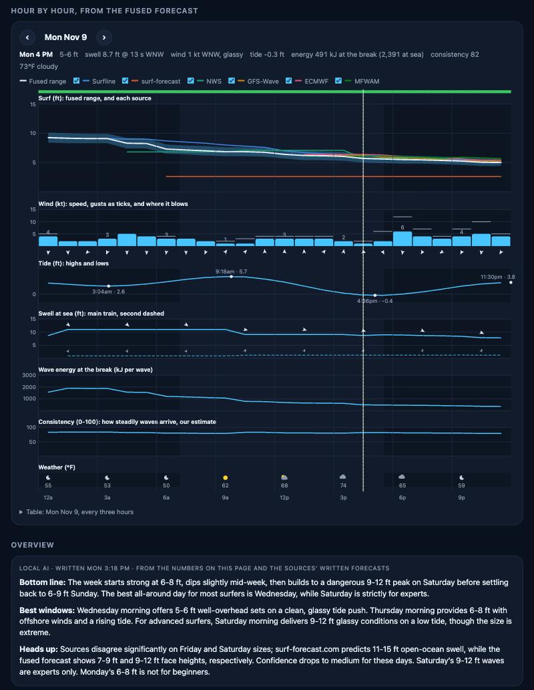

# surfslop

Bay Area surf forecasts, Capitola to Ocean Beach, for people and for agents. It reads
several forecasts, brings each one to the break, fuses them into one week-long forecast per
spot, and serves the result from your Mac: a web page for you, a small HTTP API for
[Muse](muse-skill/SKILL.md), both over Tailscale.

```
 surf-forecast.com ─┐
 NWS marine grid ───┤                      ┌─ web page (phone, laptop)
 Open-Meteo: GFS,  ─┼─▶ surfslop (Mac) ────┼─ /v1 API + SKILL.md (Muse, over Tailscale)
   ECMWF, MFWAM     │   fuse · tides ·     └─ forecast card PNG, satellite picture
 Surfline (opt-in) ─┘   buoys · local AI
```

- **Home page:** a search box, and under it the week at the seven spots of the Friday poll
  (Steamer Lane, Pleasure Point, Four Mile, Waddell Creek, Half Moon Bay, Pacifica, Ocean
  Beach): wave height per day and three pills for the morning, midday and afternoon surface.
  Below: a written "where to go" and all 38 spots.
- **Spot page:** what it is doing now (with the nearest buoy's measurement), a satellite
  picture with the swell and wind drawn on it for any hour of the week, the week day by day,
  an hourly chart of the fused forecast against every source, a written overview, and each
  source's own numbers side by side.
- **For agents:** the same data as JSON or Markdown, the satellite picture with the arrows
  burned in, and the home page preview as a PNG ready to post.

## Run it

```sh
python3 -m venv .venv && .venv/bin/pip install -e '.[dev]'
.venv/bin/surfslop serve              # http://127.0.0.1:7873, this Mac only
.venv/bin/surfslop serve --lan        # your Wi-Fi and your tailnet: phones, laptops, Muse
.venv/bin/surfslop serve --tailnet    # this Mac's Tailscale address only
.venv/bin/surfslop service install --lan       # start now and at every login (launchd)
.venv/bin/surfslop status             # addresses, sources, the daily edition, who may call
.venv/bin/surfslop serve --public --hostname surf.example.com   # the public portal, for a tunnel: PUBLIC.md
.venv/bin/pytest                      # offline tests
```

Python 3.9 or newer; the only dependency is Pillow (for the pictures). No account, password,
API key or token is needed for anything.

## Sources

| Source | What it gives | Refreshed | Weight |
|---|---|---|---|
| [surf-forecast.com](https://www.surf-forecast.com) | Its 7-day table for the break: the swell it judges to reach it, wind, rating | 3 h | 0.8 |
| [NWS marine forecast](https://www.weather.gov/mtr/) (api.weather.gov) | The Bay Area office's wave grid, edited by forecasters: swell height, period, direction, ~6 days | 1 h | 1.5 |
| [Open-Meteo](https://open-meteo.com) marine | Three wave models at each region's offshore point, 8 days: GFS-Wave (NOAA), ECMWF WAM, MFWAM (Météo-France). Also the wind at every spot | 1 h | 0.8 each |
| Surfline (off by default, see below) | Its spot forecast (LOTUS), rating and the forecaster's daily note, 5 days | once a day, slowly | 3.0 |
| NOAA NDBC buoys | What the ocean is doing now: 46042, 46236, 46012, 46026, 46237 | 20 min | shown, not fused |
| NOAA CO-OPS | Tide predictions: Santa Cruz, Pillar Point, Ocean Beach | 12 h | |
| USGS National Map | Aerial imagery of each spot (public domain), fetched once | | |

Every request says `User-Agent: surfslop/…`; nothing pretends to be a browser. Responses
are cached on disk, one request at a time per host, and a host that answers 401/403/429 is
left alone for hours (`net.py`). A source that is down is listed as down and left out; the
rest carry on.

### How the fusion works (`fusion.py`, `surf.py`)

1. **Everything becomes wave-face height at the break, hourly.** surf-forecast.com and
   Surfline already forecast the break. NWS and the wave models forecast the open ocean, so
   each swell train goes through a breaker-height formula (Komar & Gaughan: longer period,
   bigger wave) and the spot's *exposure*: how much of a S, W or NW swell reaches it
   (`spots.py`; Capitola gets a tenth of a NW swell, south Ocean Beach nine tenths). Trains
   add up by energy.
2. **Weighted mean, hour by hour**, with the weights above. The sources' disagreement is
   kept: each day gets a **confidence** (high / medium / low) from the spread and from how
   many independent families (Surfline, surf-forecast, NWS, the Open-Meteo models) agree.
3. **Wind** is a weighted circular mean of the spot-level winds. Against the direction the
   spot faces it becomes offshore / cross / onshore, then **clean / fair / blown**.
4. **Calibration.** While Surfline is on, each open-ocean source (NWS, the wave models) is
   compared with it over the hours both cover; the median ratio per spot is remembered
   (`calibration.json`) and applied from then on. It corrects how this portal brings ocean
   swell to that spot, not the shape of the forecast, and it carries Surfline-like numbers
   into days 6-8, past Surfline's own five days. surf-forecast.com forecasts the break
   itself, so its numbers are left as it gives them.
5. **Stars** (0-5) weigh size, swell period and wind; the day's best period is named.

Days 1-5 have every source; days 6-8 are wave models only, and say so through a lower
confidence. Without Surfline the first-guess exposures stand; on 9 Nov 2026 they put the
seven poll spots within a foot or two of what surfline.com showed that day.

### Hour by hour



Every hour of the week also carries, from the fused data:

| | |
|---|---|
| **Swell at sea** | The open-ocean swell: a main train and, when there is one, a second. NWS's and the three wave models' trains are matched by direction, then height and period are weighted means. Surfline's and surf-forecast.com's swells are given for points of their own near the break, so they count through their surf heights instead. |
| **Wind** | Speed, gusts and direction at the spot, and what that makes of the surface. |
| **Tide** | NOAA's prediction, with each high and low. |
| **Wave energy** | kJ per metre of crest in one wave, ρg²H²T²/16π: at sea for the fused swell, and at the break, scaled by how much of that swell's height the fused surf says arrives. |
| **Consistency** | 0-100, our own estimate of how steadily rideable waves arrive, not Surfline's number: higher for bigger surf, lower for long-period swell (long lulls between sets), a little higher when a second swell fills the lulls (`surf.consistency`). |
| **Weather** | Air temperature and sky at the spot, with sunrise and sunset per day (Open-Meteo). |

The spot page draws these as stacked panels for one day at a time, at the page's real width
so they read on a phone; the ‹ › buttons or the week strip switch the day, and a panel with
no data for that day is left out. The row above the panels shows the hour under the
crosshair, and a table of the day sits underneath. Agents get the same as a 48-hour table
in the Markdown forecast, and every field in the JSON (`hours[]`).

On an iPhone, Share → Add to Home Screen gives the portal its own icon and opens it full
screen.

### Written overview (local AI)

The spot page's *Overview* and the home page's *Where to go* are written by a local model
(here the Qwen 27B behind an
[inference-switchboard](https://github.com/duman190/inference-switchboard); any
OpenAI-compatible server works) from a terse block of the fused numbers and every source's
own numbers (`text.py`, `ai.py`). For a spot it also reads what the sources wrote: Surfline's
forecaster's note for the day (when Surfline has been read) and surf-forecast.com's summary
of the next swell, the biggest one and the weather. The model is told to combine them with
the numbers in its own words and to say where they disagree; the sources' text itself is
not shown on the page or sent to agents, apart from Surfline's one-line headline. An
overview is written once per spot per day and kept until the next edition (below); it is
written again only if the set of sources behind it changes. It streams as it is written,
and one is written at a time. Nothing leaves the
tailnet. Set `llm_url` in `config.json` (or `SURFSLOP_LLM_URL`) to the model's address, for
example `http://<its-tailscale-ip>:8000`; left empty, or with that machine asleep, the
pages simply have no overview.

The model only summarises: every number in the tables comes from the arithmetic above.

## The daily edition (`daily.py`)

Every morning at 4:00 Pacific (`daily_at` in `config.json`) the running portal makes the home
page's seven spots ready before anyone asks:

1. it reads Surfline for each of them, slowly (about half an hour for the seven);
2. it refreshes the open sources (swell, wind, weather, sun times, tides) and builds each
   spot's fused week hour by hour: surf, swell, wind, tide, wave energy, consistency, weather;
3. it keeps that whole hourly forecast on disk as the day's edition
   (`cache/edition/<spot>.json`);
4. the local model writes each spot's overview and the regional "where to go".

Everything also lands in the ordinary caches, so the first page view of the day and Muse's
Friday job read finished work, and the overviews stand for the day. During the day the cheap
open sources keep refreshing (wind and swell models update hourly); Surfline is not asked
again. If no source can be reached later on, a spot's page is served from the saved edition
for up to 36 hours.

If the portal wasn't running at 4, the edition is built when it starts (or when a sleeping
laptop wakes). A spot that isn't on the home page, or whose morning read failed, isn't left
out: opening it queues a Surfline read in the background and the page reloads itself when
it lands; its overview is written on first view and then kept for the day too.
`surfslop status` shows when the last edition was built.

## Public mode

`surfslop serve --public` serves the portal to the internet through a Cloudflare Tunnel, the
way the Lynch Pin portal does, with a stats page for the tailnet only. It shows the open
sources only: no Surfline and no surf-forecast.com data. See [PUBLIC.md](PUBLIC.md).

## Surfline

**Off until you turn it on:** `surfslop source surfline on` (and `off` to undo).

What turning it on does: surfslop reads the forecast that surfline.com shows a visitor who
is *not signed in*: five days of surf height, swell, wind, rating and the forecaster's
headline for a spot. It asks for those five days and nothing more and identifies itself as
surfslop. It reads slowly, in the background of the running portal: ten seconds between
its five requests for a spot, three minutes between spots, and each spot once a day (the
home page's seven in the daily edition, any other when someone first opens it); pages
never wait on it. That is 35 requests a day for the home page's spots. It does not sign in,
send a token, or try another way in.

The pace matters. On the first live run (9 Nov 2026) surfslop sent a spot's five requests
within three seconds; Surfline answered four and refused the fifth with a 403. At the
present pace, ten seconds apart, it answered every request for the spots read that day.
It may still refuse at times: when it does, surfslop stops asking for six hours (remembered
on disk), keeps using the last copy for up to a day, and shows how old it is. Each time a spot is read, the other sources are re-scaled to it (see
Calibration), so even occasional Surfline data keeps improving that spot's forecast.

Why it is your call: Surfline has no public API, its terms of use restrict automated
access, and its site turns most non-browser clients away. Reading the signed-out forecast
for your own private page is a small thing, but it is their service and their rules, so the
switch is yours, and the portal works without it.

## Agents (Muse)

```sh
surfslop serve --tailnet          # or: surfslop service install --tailnet
surfslop status                   # "over Tailscale: http://100.x.y.z:7873"
surfslop peers muse               # optional: only Muse (and this Mac) may call
```

Give Muse the address as `SURFSLOP_URL` and [muse-skill/SKILL.md](muse-skill/SKILL.md) as a
workspace skill. There is no token: on a tailnet an address belongs to one device's key and
can't be spoofed.

```sh
curl -s "$SURFSLOP_URL/v1/overview?format=md"                # the seven spots, next 3 days
curl -s "$SURFSLOP_URL/v1/forecast/ocean-beach?format=md"    # one spot, a week, every source
curl -s "$SURFSLOP_URL/v1/forecast/OB?hours=0&ai=1"          # JSON, with the written overview
curl -s "$SURFSLOP_URL/v1/satellite/steamer-lane.jpg?arrows=1" -o lane.jpg
curl -s "$SURFSLOP_URL/v1/card.png?days=3" -o forecast.png   # the poll's picture
```

`/llms.txt` describes the API to an agent that finds the portal by itself. The same
forecasts are on the command line: `surfslop forecast ocean beach`, `surfslop overview`.

## Security

- **Read-only.** Every endpoint is a GET; nothing changes state, and there is nothing secret
  to read.
- **Who may call** (`netguard.py`): this Mac, private networks and Tailscale
  (`100.64.0.0/10`). Anything else gets 403, as does a request with a foreign `Host` header
  (DNS rebinding) or one that a page on another site makes through your browser
  (`Sec-Fetch-Site`). `surfslop peers muse` narrows callers to named tailnet devices.
- **Where it listens:** `serve` on 127.0.0.1 only; `--tailnet` adds the Mac's Tailscale
  address; `--lan` listens everywhere (still private and Tailscale callers only). Don't
  port-forward it or put it behind Funnel.
- **The page** loads nothing from other sites (`Content-Security-Policy: default-src
  'self'`) and sets text as text, never as HTML.
- The Mac has to be awake: a sleeping Mac is off the tailnet.

## Files

`~/Library/Application Support/surfslop/` (`SURFSLOP_HOME` overrides): `config.json`,
`calibration.json`, and `cache/` (source responses, satellite pictures, AI overviews). All
of it can be deleted; it is rebuilt on the next request. The log of the launchd service is
`~/Library/Logs/surfslop.log`.

| | |
|---|---|
| `src/surfslop/spots.py` | the 38 spots: position, facing, exposure, each source's name for it |
| `src/surfslop/sources/` | one module per forecast source |
| `src/surfslop/surf.py`, `fusion.py` | swell → wave at the break; the fusion |
| `src/surfslop/obs.py` | buoys and tides |
| `src/surfslop/ai.py`, `text.py` | the written overview; Markdown for agents |
| `src/surfslop/daily.py` | the 4 AM edition |
| `src/surfslop/stats.py` | the public portal's stats and their tailnet-only page |
| `src/surfslop/satellite.py`, `card.py` | the pictures |
| `src/surfslop/server.py`, `netguard.py`, `cli.py` | the portal, who may call, the commands |
| `src/surfslop/static/` | the web page |

A forecast, not a promise: check the water before you paddle out.
